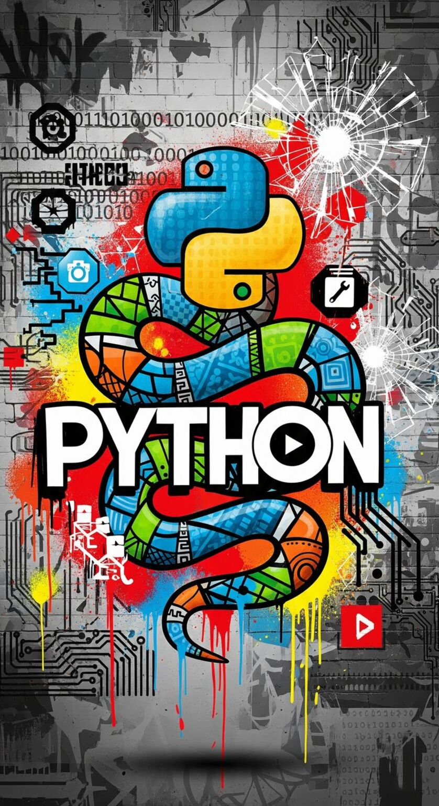

# TelegramQaBots



Коллекция Telegram-ботов на Python, которые помогают QA-специалисту в работе и обучении: от словаря терминов и валидатора JSON до генератора номеров финансовых карт для тестовых данных. Каждый бот — самостоятельный скрипт, запускается отдельно.

## Состав проекта

| Бот | Файл | Назначение |
|-----|------|------------|
| `PersonalPortfolioBot` | `personal_portfolio_bot.py` | Персональная визитка в Telegram: об авторе, портфолио и способах связи. |
| `QaVocabularyBot` | `qa_vocabulary_bot.py` | Карманный словарь QA-терминов: быстрые справки по терминологии тестирования. |
| `JsonVerifierBot` | `json_verifier_bot.py` | Проверяет JSON-файлы: корректность синтаксиса и правила оформления |
| `CardNumberGeneratorBot` | `card_number_generator_bot.py` | Генерирует номера финансовых карт различных платёжных систем — для тестирования и подготовки тестовых данных. |

## Технологии и библиотеки

- **Python 3.x** — язык разработки;
- **[pyTelegramBotAPI](https://pypi.org/project/pyTelegramBotAPI/)** (`telebot`) — фреймворк для работы с Telegram Bot API;
- **[Faker](https://pypi.org/project/Faker/)** — генерация правдоподобных тестовых данных, включая номера финансовых карт;
- **[pipreqs](https://pypi.org/project/pipreqs/)** — автогенерация `requirements.txt` по импортам проекта (инструмент разработки).
- **[telegram bots api available-methods](https://core.telegram.org/bots/api#available-methods)** — Все методы Bot API, поддерживаются HTTP-методы GET и POST. При успешном вызове будет возвращен JSON-объект с результатом.

## Установка и запуск

1. Склонируйте репозиторий:

   ```bash
   git clone git@github.com:Napster256/TelegramQaBots.git
   cd TelegramQaBots
   ```

2. Установите зависимости:

   ```bash
   pip install -r requirements.txt
   ```

3. Задайте токен бота через переменную окружения:

   ```python
   from os import environ
   from dotenv import load_dotenv
   load_dotenv()
   TOKEN = environ['personal_portfolio_bot']
   ```

   Токен выдаётся [@BotFather](https://t.me/BotFather) при создании бота.

1. Запустите нужного бота:

   ```bash
   python personal_portfolio_bot.py
   python qa_vocabulary_bot.py
   python json_verifier_bot.py
   python card_number_generator_bot.py
   ```

## Актуализация зависимостей (pipreqs)

`requirements.txt` генерируется автоматически по импортам в коде:

```bash
pip install pipreqs
pipreqs . --savepath static/requirements.txt --force --ignore .venv --encoding utf-8
```

---
© 2024 TelegramQaBots. Все права защищены.